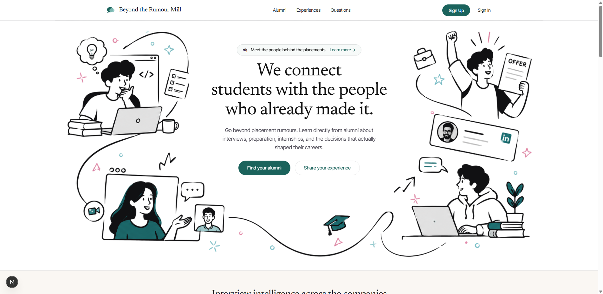
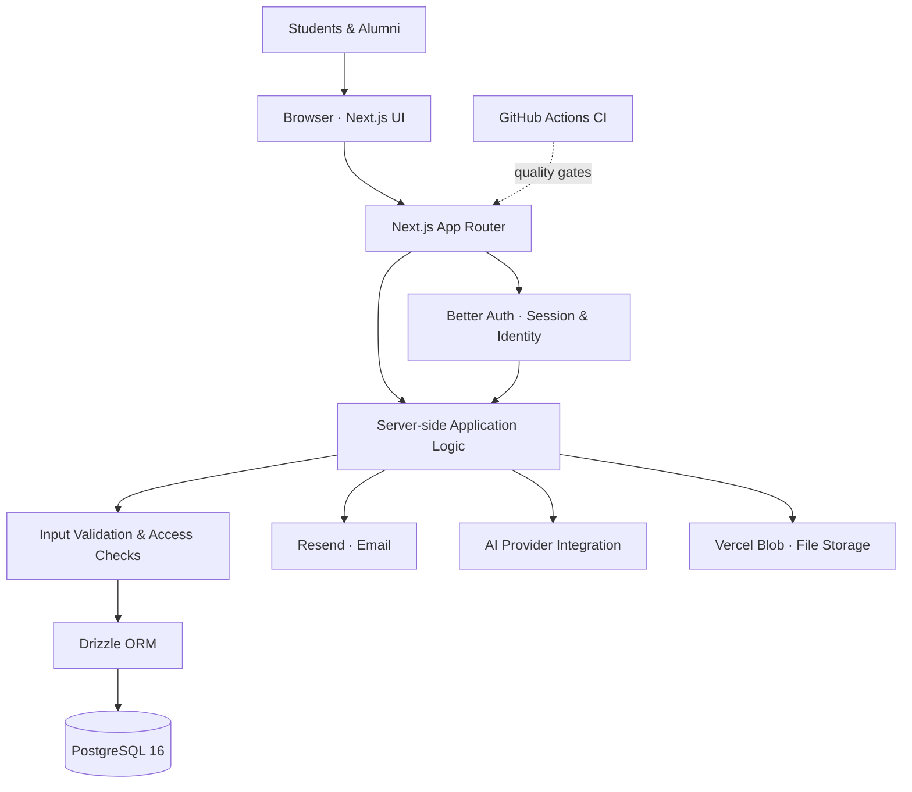

<!-- Project header -->
<div align="center">

# Beyond the Rumour Mill

### Less hearsay. More signal. Better preparation.

A placement intelligence platform that brings interview experiences, career insights, and alumni guidance into one structured community.

<p>
  <a href="https://github.com/Jyatin/beyond-the-rumour-mill/actions/workflows/ci.yml">
    
  </a>
  
  
  
  
</p>

<p>
  <a href="#-overview">Overview</a> ·
  <a href="#-product-highlights">Features</a> ·
  <a href="#-architecture">Architecture</a> ·
  <a href="#-tech-stack">Tech Stack</a> ·
  <a href="#-getting-started">Get Started</a> ·
  <a href="#-contributing">Contribute</a>
</p>

</div>

---

## 📸 A First Look

<p align="center">
  
  
</p>

<p align="center">
  <sub>Product visuals from the current development branch.</sub>
</p>

## 🎯 Overview

**Beyond the Rumour Mill** is a community-driven placement intelligence platform built to make campus hiring information easier to discover, evaluate, and act on.

Students often prepare for interviews using scattered WhatsApp messages, outdated question lists, and second-hand accounts. The platform brings these experiences into a structured knowledge base—organised by company, role, hiring cycle, interview round, and topic—while creating a path for students to connect with alumni who have already navigated those hiring processes.

> **The idea:** turn scattered placement stories into structured, contextual, and verifiable career knowledge.

## 💡 The Problem We're Solving

| The usual experience | What the platform aims to enable |
| --- | --- |
| Interview information scattered across chats and documents | Searchable company- and role-specific experiences |
| Unclear source, recency, and reliability | Contextual submissions with verification signals |
| The same preparation questions asked repeatedly | Reusable interview knowledge and preparation insights |
| Difficult to find the right senior for guidance | Alumni discovery and mentorship workflows |

## ✨ Product Highlights

<table>
  <tr>
    <td width="50%" valign="top">
      <h3>🧠 Interview Intelligence</h3>
      Organise first-hand interview experiences by company, role, hiring cycle, round, difficulty, and topic.
    </td>
    <td width="50%" valign="top">
      <h3>🔎 Evidence & Verification</h3>
      Build trust through structured submissions, verification states, moderation, and clear source context.
    </td>
  </tr>
  <tr>
    <td width="50%" valign="top">
      <h3>🤝 Alumni Connect</h3>
      Help students discover relevant alumni and create pathways for mentorship, mock interviews, and career conversations.
    </td>
    <td width="50%" valign="top">
      <h3>📚 Placement Preparation</h3>
      Bring company information, role context, hiring rounds, and preparation resources into one experience.
    </td>
  </tr>
</table>

<details>
  <summary><strong>How the experience is designed to work</strong></summary>
  <br />

  1. **Contribute:** Students and alumni submit structured interview experiences and relevant context.
  2. **Review:** Submissions can be reviewed, moderated, and associated with verification signals.
  3. **Discover:** Students explore information by company, role, hiring cycle, and interview round.
  4. **Connect:** Candidates find relevant alumni and seek guidance based on real experience.
</details>

> [!NOTE]
> The repository is actively evolving. Some areas have working application flows and full-stack foundations; other product workflows are still being integrated. The highlights describe the product direction and current foundations, not a claim that every feature is production-ready.

## 🏗️ Architecture & System Design

The platform follows a **modular monolith** approach: one Next.js application contains the product UI and server-side capabilities, while authentication, persistence, and external integrations remain clearly separated. This keeps development and deployment straightforward without preventing the system from evolving into more specialised services later.

### High-level system design



### How a request flows

1. **User interaction:** A student or alumnus opens a page or submits information through the Next.js interface.
2. **Routing and identity:** The App Router handles the request; Better Auth provides session and authentication context where required.
3. **Application logic:** Server-side code validates input and applies the relevant access and business rules.
4. **Data access:** Drizzle ORM reads or writes structured records in PostgreSQL. The database is the primary source of truth.
5. **External capabilities:** Server-side integrations connect to email delivery, AI services, and object storage when a workflow needs them.

### Key design decisions

| Concern | Design approach |
| --- | --- |
| Application structure | Modular monolith using the Next.js App Router; keeps related product logic together |
| Identity & access | Better Auth manages authentication and session context |
| Data consistency | PostgreSQL stores relational application data; Drizzle provides typed queries and migrations |
| Integrations | Email, AI, and file storage are handled through server-side integrations rather than browser-exposed credentials |
| Maintainability | TypeScript, reusable components, tests, and CI checks help catch regressions |

> **Scope note:** This diagram describes the current application foundation and intended request boundaries. Individual product workflows and integrations are being implemented incrementally; it does not imply that every planned feature is already production-ready.

### Engineering foundations

- **Application:** Next.js App Router with React Server and Client Components.
- **Authentication:** Better Auth with database-backed user records and optional social provider configuration.
- **Persistence:** PostgreSQL with Drizzle ORM and versioned schema migrations.
- **External services:** Resend for email, configurable AI provider integration, and Vercel Blob for object storage.
- **Quality:** Vitest, ESLint, TypeScript checks, and a GitHub Actions CI workflow.

## 🧰 Tech Stack

| Area | Tools |
| --- | --- |
| Framework | [Next.js 16](https://nextjs.org/) · [React 19](https://react.dev/) |
| Language | [TypeScript](https://www.typescriptlang.org/) |
| Styling | [Tailwind CSS 4](https://tailwindcss.com/) |
| UI & Interaction | [Radix UI](https://www.radix-ui.com/) · [Motion](https://motion.dev/) · [Lucide](https://lucide.dev/) · [CMDK](https://cmdk.paco.me/) |
| Authentication | [Better Auth](https://www.better-auth.com/) |
| Database | [PostgreSQL 16](https://www.postgresql.org/) |
| ORM & Migrations | [Drizzle ORM](https://orm.drizzle.team/) |
| Email & Storage | [Resend](https://resend.com/) · [Vercel Blob](https://vercel.com/docs/vercel-blob) |
| Testing & CI | [Vitest](https://vitest.dev/) · ESLint · GitHub Actions |
| Local Infrastructure | Docker Compose |

## 📂 Repository Structure

```text
beyond-the-rumour-mill/
├── .github/
│   └── workflows/
│       └── ci.yml                 # CI: database, lint, types, tests & build
├── drizzle/                       # Database migration files
├── public/                        # Static assets and product visuals
├── scripts/
│   └── seed.ts                    # Development database seeding
├── src/
│   ├── app/                       # App Router pages, layouts and routes
│   ├── components/                # Reusable product and UI components
│   ├── hooks/                     # Shared React hooks
│   ├── lib/                       # Shared utilities and application helpers
│   └── server/
│       ├── auth.ts                # Better Auth configuration
│       └── db/
│           ├── index.ts           # PostgreSQL / Drizzle client
│           └── schema.ts          # Database schema
├── tests/                         # Automated tests
├── .env.example                   # Environment configuration template
├── docker-compose.yml             # Local PostgreSQL service
├── drizzle.config.ts              # Drizzle Kit configuration
├── package.json
└── README.md
```

## 🚀 Getting Started

### Prerequisites

- [Node.js 20+](https://nodejs.org/)
- npm
- [Docker Desktop](https://www.docker.com/products/docker-desktop/) for local PostgreSQL

### 1. Clone the repository

```bash
git clone https://github.com/Jyatin/beyond-the-rumour-mill.git
cd beyond-the-rumour-mill
```

### 2. Install dependencies

```bash
npm ci
```

### 3. Configure environment variables

```bash
cp .env.example .env
```

Update the values in `.env` for your local environment. The supplied Docker Compose configuration uses PostgreSQL on port `54320`.

### 4. Start the database

```bash
docker compose up -d
```

### 5. Apply migrations and seed local data

```bash
npm run db:migrate
npm run db:seed
```

### 6. Start the development server

```bash
npm run dev
```

Visit **http://localhost:3000** to open the application.

## ⚙️ Configuration

The `.env.example` file documents the supported configuration.

| Variable | Purpose |
| --- | --- |
| `DATABASE_URL` | PostgreSQL connection string |
| `BETTER_AUTH_SECRET` | Better Auth secret |
| `BETTER_AUTH_URL` | Application authentication base URL |
| `RESEND_API_KEY` / `EMAIL_FROM` | Email delivery configuration |
| `AI_PROVIDER` / `AI_MODEL` / `AI_API_KEY` | AI provider and model configuration |
| `GOOGLE_CLIENT_ID` / `GOOGLE_CLIENT_SECRET` | Optional Google OAuth |
| `LINKEDIN_CLIENT_ID` / `LINKEDIN_CLIENT_SECRET` | Optional LinkedIn OAuth |
| `BLOB_READ_WRITE_TOKEN` | Vercel Blob access token |
| `STORAGE_DIR` | Optional local storage directory |

Keep credentials in your local `.env` file or deployment environment. Never commit real secrets.

## 🧪 Quality Checks

Run the following commands before opening a pull request:

```bash
# Lint
npm run lint

# TypeScript
npx tsc --noEmit

# Automated tests
npm run test

# Production build
npm run build
```

### Continuous Integration

The GitHub Actions workflow provisions PostgreSQL 16 and runs:

1. Dependency installation
2. Database migrations and seed
3. ESLint
4. TypeScript compilation
5. Vitest test suite
6. Next.js production build

[View the CI workflow](.github/workflows/ci.yml).

## 📜 Available Scripts

| Command | Description |
| --- | --- |
| `npm run dev` | Start the development server |
| `npm run build` | Build the production application |
| `npm run start` | Start the production server |
| `npm run lint` | Run ESLint |
| `npm run test` | Run Vitest |
| `npm run db:generate` | Generate database migrations |
| `npm run db:migrate` | Apply database migrations |
| `npm run db:push` | Push schema changes to the database |
| `npm run db:seed` | Seed development data |
| `npm run db:studio` | Open Drizzle Studio |

## 🗺️ Roadmap

- [x] Next.js application foundation
- [x] PostgreSQL and Drizzle ORM integration
- [x] Better Auth integration
- [x] Database migration and seed workflow
- [x] Vitest and GitHub Actions CI foundation
- [ ] Complete end-to-end interview submission workflows
- [ ] Expand verification and moderation workflows
- [ ] Production-ready alumni discovery and mentorship
- [ ] Rich search and interview intelligence experiences

## 🤝 Contributing

Contributions, bug reports, and product feedback are welcome.

1. Fork the repository.
2. Create a branch: `git checkout -b feat/your-feature`.
3. Make your changes and add tests where relevant.
4. Run lint, type checks, tests, and the production build.
5. Commit with a clear message and open a pull request.

Please do not include credentials, private candidate information, or unverified personal data in sample content.

## 👨‍💻 Maintainer

**Jyatin Singh** · [GitHub](https://github.com/Jyatin) · [LinkedIn](https://www.linkedin.com/in/jyatinsingh/)

---

<div align="center">

### Beyond the Rumour Mill

**Less hearsay. More signal. Better preparation.**

<sub>Built to make career knowledge more transparent and accessible.</sub>

</div>
